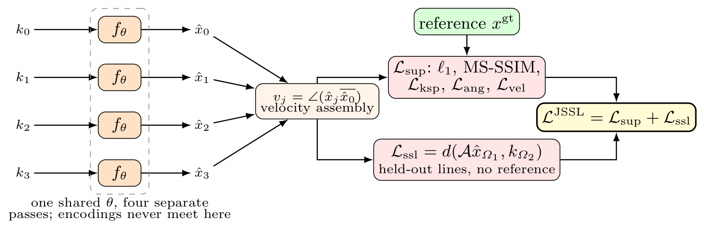
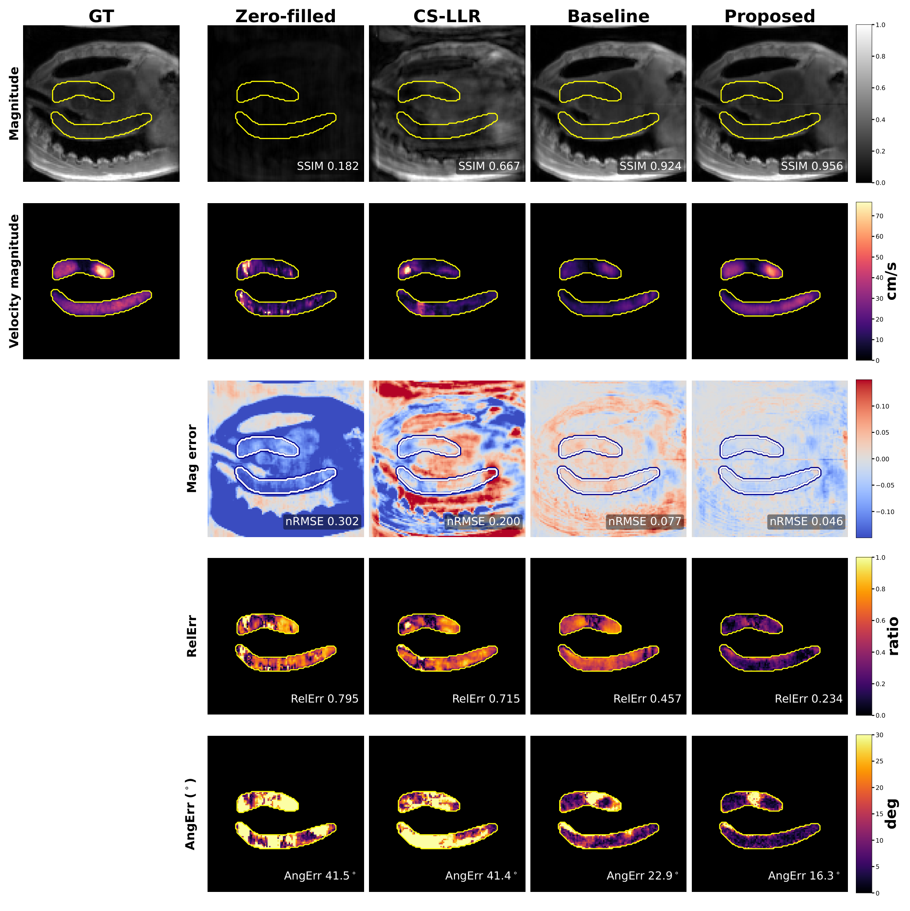

# [Joint Supervised and Self-Supervised Training with Acquisition-Robust Techniques for Accelerated 4D Flow MRI Reconstruction](https://papers.miccai.org/miccai-2026-sat/paper/CMRxRecon2026_016.pdf)

📄 Paper: **Mengyuan Xue**, **Bochun Mei** (Equal Contribution), STACOM 2026 / CMRx4DFlow 2026 challenge, MICCAI 2026 (open access).

📎 Supplementary files: [CMRxRecon2026_016_supp.pdf](https://papers.miccai.org/miccai-2026-sat/supp/CMRxRecon2026_016_supp.pdf)

Contact **Mengyuan Xue** (mengyuan.xue@utsouthwestern.edu) or **Bochun Mei** (bochun.mei@ucsf.edu) for any questions or requests.

[](LICENSE)

## Method overview

In 4D flow MRI, the diagnostic signal is the phase difference *between* velocity encodings, not the image magnitude.
This repository trains a physics-driven unrolled variational network that reconstructs each encoding separately
(a per-encoding FlowVN), and adds the following:

- **JSSL**, a joint supervised + self-supervised objective. Each step pairs a supervised sample with a reference-free
  SSDU sample and optimizes `L = L_sup + L_ssl` ([Yiasemis et al. 2025]; SSDU: [Yaman et al. 2020]).
- **Velocity-aware supervision.** On top of ℓ1 + MS-SSIM on magnitude, a direction loss `L_ang` and a wrapped
  per-component velocity loss `L_vel` are computed across the separately reconstructed encodings. Both are weighted by
  ground-truth velocity magnitude.
- **A dual-domain k-space term.** `L_ksp` is a normalized ℓ2+ℓ1 discrepancy on the acquired lines, and it is
  scale-invariant across vendors.
- **Acceleration conditioning.** The stage weights λ_R(R) and λ_D(R) are learned piecewise-linear functions of the true
  acceleration R, so one model covers R = 10–50.
- **Acquisition-robust techniques:**
  - learned, zero-initialized coil-map refinement inside the unroll;
  - winsorized-RMS k-space normalization;
  - coil-map jitter, k-space noise and readout phase-ramp augmentation;
  - scanner-balanced sampling.

<p align="center">
  
</p>


## Repository Structure

```
main.py                   training / validation / test (PyTorch Lightning)

networks/
  flowvn.py               per-encoding FlowVN used in the paper (bounded momentum, R-conditioning, CSM refinement)
  flowvn_baseline.py      paper-faithful FlowVN without our changes (--baseline)

utils/
  dataloader.py           CMRx4DFlow loader, k-t Gaussian undersampling, SSDU split, augmentation, JSSL dataset
  misc_utils.py           MRI forward/adjoint operators, complex layers
  ktgaussian.py           k-t Gaussian sampling masks
  partitioning.py         SSDU k-space partitioning
  CS_LLR_*.py             compressed-sensing locally-low-rank baseline

  train_opt.py            parses a run's train_opt.txt (used by the evaluation scripts)

board_eval.py             full-volume, leaderboard-faithful evaluation (MSAC-corrected metrics per R)
generate_gt.py            fully-sampled adjoint reference reconstruction
scripts/                  train_jssl.sh, test.sh, eval_heldout.sh
tools/                    data split, offline re-scoring, qualitative figure
cmr_helper_scripts/       challenge evaluation code (third-party, Apache-2.0)
assets/                   figures
```

## Installation

```bash
conda create -n flowjssl python=3.10 -y && conda activate flowjssl
pip install torch==2.3.1 torchvision==0.18.1 --index-url https://download.pytorch.org/whl/cu121   # pick the build for your GPU
pip install pytorch-lightning==1.9.5 lightning-bolts==0.7.0
pip install -r requirements.txt
```

The code requires **PyTorch Lightning 1.9.5** (with `lightning-bolts` 0.7.0). It uses the Lightning 1.x Trainer API
(`replace_sampler_ddp`, integer `precision`), which Lightning 2.x removed. `lightning-bolts` depends on torchvision, so
install the torchvision build that matches your torch (0.18.1 for torch 2.3.1); otherwise pip pulls in a newer torch.

## Data

Download the CMRx4DFlow 2026 data from the [challenge website](https://cmrxrecon.github.io/) and point `DATA` at the
folder that contains `TaskR1R2/`, `TaskS1/` and `TaskS2/`. Each subject folder
(`<Task>/<Set>/<Anatomy>/<Center>/<Vendor>/<Patient>/`) is expected to contain `params.csv`, `coilmap.mat` and
`segmask.mat`. It also needs either `kdata_full.mat` (TrainSet) or `kdata_ktGaussian{R}.mat` (Validation/Test).
**No data is distributed with this repository.**

Create the stratified training / held-out split (~10% of every center; this copies the data):

```bash
export DATA=/path/to/CMR_Data
python tools/make_split.py --src $DATA/TaskR1R2/TrainSet/Aorta     # -> Aorta_train/, Aorta_heldout/
```

The paper uses three groups that do not share any subject:

- the supervised stream (119 subjects);
- all of `Center011` as the reference-free self-supervised stream (6 subjects);
- the held-out subjects for local evaluation.

## Training

```bash
GPU=0 bash scripts/train_jssl.sh
```

Runs are logged to `results/corrected_runs/lightning_logs/version_N/`. Each run folder holds TensorBoard events,
`train_opt.txt` and the checkpoints. `python main.py --help` documents every option. `--zero_filled` represents the learning-free floor.


## Evaluation and inference

These commands score held-out training subjects at every R ∈ {10, 20, 30, 40, 50}, using the challenge pipeline:
MSAC background-phase correction, then SSIM / nRMSE / RelErr / AngErr inside the segmentation mask.

```bash
VERSION_DIR=results/corrected_runs/lightning_logs/version_0 bash scripts/eval_heldout.sh
```

The next command reconstructs the official ValidationSet in the challenge submission format
(`img_ktGaussian{R}.npz` and `recontime_ktGaussian{R}.csv`):

```bash
CKPT=path/to/model.ckpt OUT=results/submission bash scripts/test.sh
```

The model is rebuilt from the CLI flags at test time. Therefore the architecture flags and `--robust_norm` must match
the ones used in training.

## Results

<p align="center">
  
</p>


The proposed model and the FlowVN baseline are evaluated as frozen models on out-of-distribution data (zero-shot).

| Setting | SSIM ↑ | nRMSE ↓ | RelErr ↓ | AngErr (°) ↓ |
|---|---|---|---|---|
| Cross-site, **proposed** | **0.942** | **0.084** | **0.467** | **28.98** |
| Cross-site, supervised only (no joint objective) | 0.938 | 0.086 | 0.488 | 29.39 |
| Cross-site, FlowVN baseline | 0.879 | 0.123 | 0.677 | 46.67 |
| Cross-organ mean, **proposed** | **0.966** | **0.052** | **0.398** | **29.51** |
| Cross-organ mean, FlowVN baseline | 0.957 | 0.065 | 0.473 | 36.67 |


## Acknowledgements

The challenge evaluation code in `cmr_helper_scripts/` and the k-t Gaussian undersampling mask generation in
`utils/ktgaussian.py` are provided by the CMRx4DFlow 2026 challenge organizers
([CmrxRecon/CMRx4DFlow2026](https://github.com/CmrxRecon/CMRx4DFlow2026)). We thank them for making these tools available.

## Citation

```bibtex
@article{xue2026joint,
  title={Joint Supervised and Self-Supervised Training with Acquisition-Robust Techniques for Accelerated 4D Flow MRI Reconstruction},
  author={Xue, Mengyuan and Mei, Bochun},
  journal={arXiv preprint arXiv:2609.38644},
  year={2026}
}
```

## License

MIT (see [LICENSE](LICENSE)). Third-party code in `cmr_helper_scripts/` is under Apache-2.0.

[Yiasemis et al. 2025]: https://arxiv.org/abs/2311.15856
[Yaman et al. 2020]: https://doi.org/10.1002/mrm.28378
